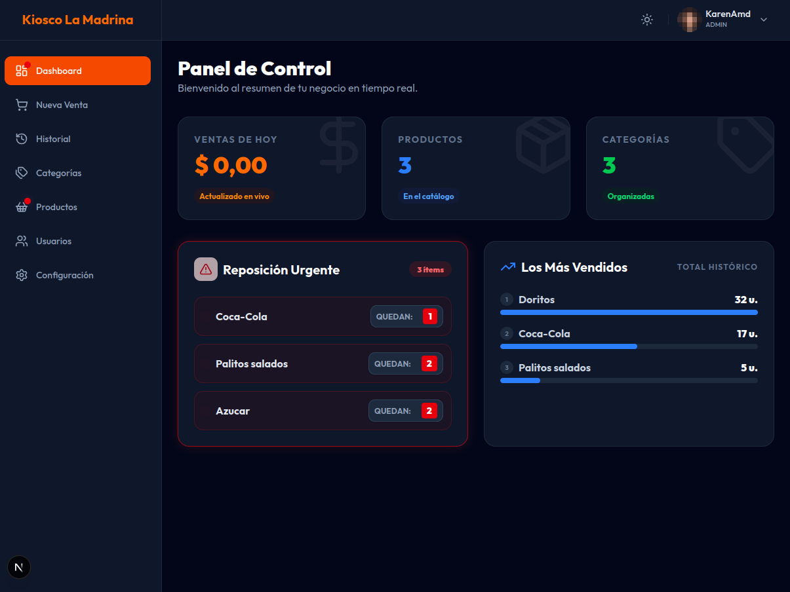
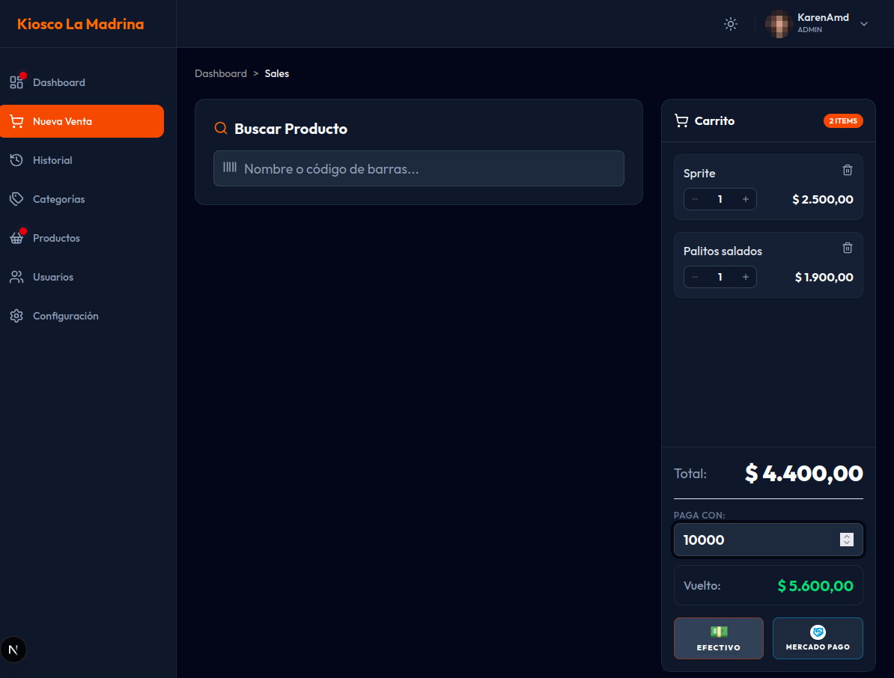
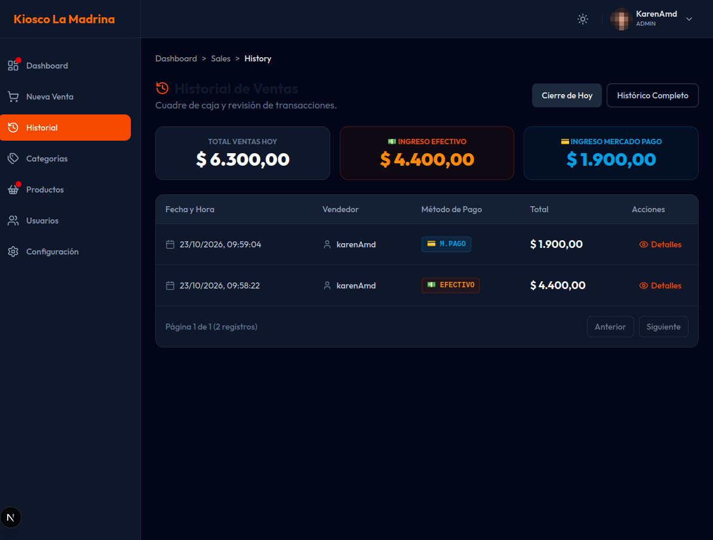
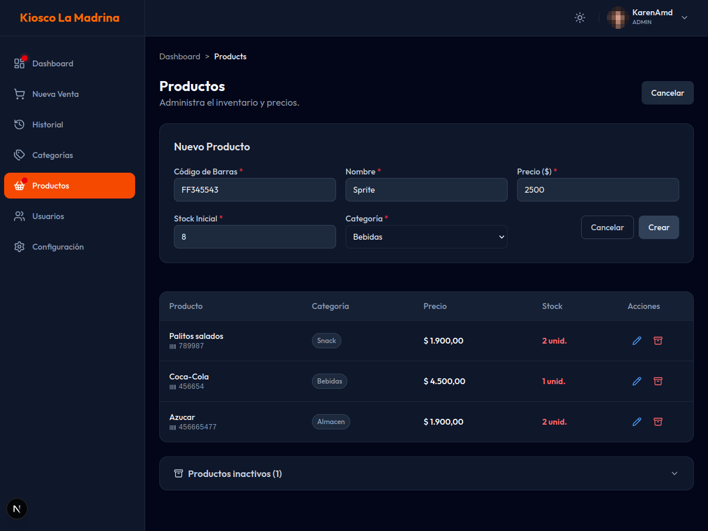
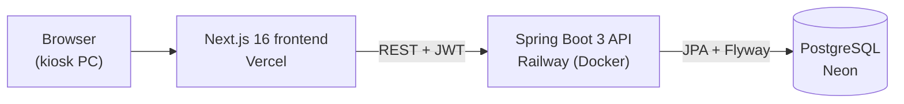

# Kiosco La Madrina

[](https://github.com/MamaniMarioOrlando/kiosco-la-madrina/actions/workflows/maven.yml)


[](LICENSE)

Point-of-sale and inventory system for a real neighborhood kiosk in Argentina: sales at the counter,
stock control, daily cash closing and sales statistics, with separate roles for the owner and the employees.

**Live app:** [kiosco-la-madrina.vercel.app](https://kiosco-la-madrina.vercel.app) — it holds the kiosk's real
data, so access is available on request.

| Dashboard | New sale |
|---|---|
|  |  |
| **Sales history** | **Products** |
|  |  |

## Features

- **Point of sale:** search by barcode or name, cart, cash or Mercado Pago, change calculation.
- **Inventory:** products and categories, low-stock alerts. Products are deactivated instead of deleted, so
  the sales history keeps them, and an admin can reactivate them.
- **Dashboard and history:** today's totals by payment method, daily cash closing, top sellers, every sale
  with its items.
- **Users and roles:** no public sign-up. An `ADMIN` creates accounts and can deactivate them, which cuts
  access immediately, even for open sessions. `EMPLOYEE` users sell and check information.
- **Dark and light themes**, responsive layout, Argentine currency and date formats.

## Engineering highlights

The interesting part of this project is not the CRUD but the problems that show up once real people use it:

- **No overselling under concurrency.** Two checkouts selling the last unit at the same time used to both
  succeed. Stock is now decremented with a single conditional `UPDATE ... WHERE stock >= quantity`, proven
  by a test that fires 20 parallel sales at a stock of 5 against real PostgreSQL.
- **Defense in depth for data.** The same rules (price above 0 and up to 10 million, stock from 0 to 100,000)
  are enforced by the form, the API (Bean Validation) and the database (`CHECK` constraints), so data that
  bypasses the app is still rejected. This came out of a [real incident](docs/incidents.md).
- **Time zones done right.** Sales are stored as UTC instants; a business day is 00:00–23:59 in
  `America/Argentina/Buenos_Aires`. Before this, a sale at 23:30 landed on the next day because the server
  runs in UTC. The clock is injected, so tests can pin the time.
- **Secure by default.** The app refuses to start with a weak or sample JWT secret. Login is locked after
  5 failed attempts per account and network, plus a per-IP rate limit. Errors never leak internals, and
  Swagger and SQL logging only exist in the `dev` profile.
- **Real database in tests.** Every test that touches the database runs on PostgreSQL with Testcontainers,
  not an in-memory substitute, because H2 does not behave like production.
- **Versioned schema.** Flyway migrations, including guarded data fixes that are no-ops on any other
  database.
- **Incident log.** [docs/incidents.md](docs/incidents.md) records what went wrong in production and how it
  was handled, including the response to a hosting provider's secrets leak (written in Spanish).

## Architecture



The backend follows a classic layered design: controllers, services, repositories, with DTOs (MapStruct)
at the edges and domain logic in the entities where it belongs (for example, `Sale.addItem` keeps the total
consistent and snapshots the unit price).

| | |
|---|---|
| **Backend** | Java 21, Spring Boot 3.4, Spring Security, JWT (jjwt), Spring Data JPA, Flyway, MapStruct, Lombok, Bucket4j + Caffeine |
| **Frontend** | Next.js 16 (App Router), React 19, TypeScript, Tailwind CSS 4, shadcn/ui, Axios, Sonner |
| **Database** | PostgreSQL 16 (local) / 17 (Neon) |
| **Testing** | JUnit 5, Mockito, MockMvc, Testcontainers |
| **CI/CD** | GitHub Actions on every pull request; Vercel and Railway deploy `main` |

## Testing

More than 140 automated tests (unit and integration) with about 89% line coverage of the backend
(measured with JaCoCo). Every test that guards a bug fix was written first and seen failing, so it is
known to catch the bug. Docker must be running:

```bash
./mvnw test
```

## Running locally

**Requirements:** Java 21, Node.js 20+, Docker.

1. **Database** (PostgreSQL on port 5433, so it does not clash with other local projects):

   ```bash
   docker compose up -d
   ```

2. **Environment.** Create a `.env` file in the project root (it is git-ignored):

   ```bash
   DB_URL=jdbc:postgresql://localhost:5433/kiosco_db
   DB_USERNAME=postgres
   DB_PASSWORD=password
   JWT_SECRET_KEY=   # generate with: openssl rand -base64 32
   # First admin, created on startup only if no ADMIN exists yet
   ADMIN_USERNAME=admin
   ADMIN_PASSWORD=   # at least 8 characters
   ADMIN_EMAIL=admin@example.com
   ```

3. **Backend** at `http://localhost:8080` (`dev` profile, Swagger at `/swagger-ui/index.html`):

   ```bash
   ./mvnw spring-boot:run
   ```

4. **Frontend** at `http://localhost:3001`:

   ```bash
   cd frontend
   npm install
   npm run dev
   ```

## Deployment

Merging to `main` deploys the frontend to Vercel and the backend to Railway. The backend runs without a
profile, which is the secure production configuration.

| Railway variable | Purpose |
|---|---|
| `DB_URL`, `DB_USERNAME`, `DB_PASSWORD` | Neon connection. Keep the password only in `DB_PASSWORD` |
| `JWT_SECRET_KEY` | Signs sessions. The app will not start if it is missing or weak |
| `ALLOWED_ORIGINS` | CORS: the frontend URL only, never `*` |
| `SERVER_TOMCAT_REMOTEIP_INTERNALPROXIES` | `.*`, to read the client IP behind Railway's proxy. Safe only behind a proxy that overwrites `X-Forwarded-For` |
| `JWT_EXPIRATION` | Optional session length, `12h` by default |
| `KIOSCO_TIME_ZONE` | Optional business time zone, `America/Argentina/Buenos_Aires` by default |

Vercel only needs `NEXT_PUBLIC_API_URL`, pointing to the Railway API (`https://<service>.up.railway.app/api`).

## License

[MIT](LICENSE)
