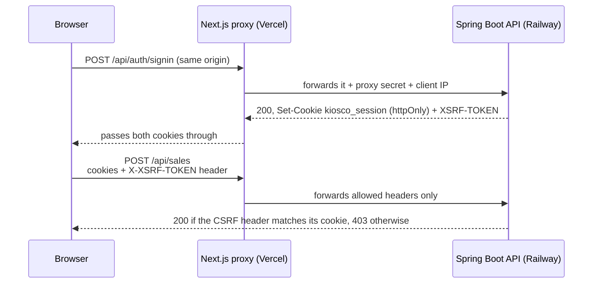

# Session security

How the browser session works, why it is built this way, and what it does not protect against yet.

## The request path

1. **The browser only talks to its own origin.** A Next.js route handler (`frontend/src/app/api/[...path]`)
   forwards `/api/*` to Railway. The backend has no CORS configuration: no other site gets permission to
   read its responses, and the frontend's Content Security Policy only allows `connect-src 'self'`.
2. **The proxy forwards an allowlist of headers**, not everything the browser sends. A new header has to be
   added on purpose.
3. **The backend trusts the proxy only with a shared secret.** With `X-Kiosco-Proxy-Secret` equal to
   `PROXY_SECRET`, the backend reads the real client IP from `X-Kiosco-Client-IP`, so rate limiting counts
   each client instead of Vercel. Without the secret, that header is ignored. The secret lives only in
   Railway and Vercel server-side variables, never in the browser bundle.

## The session cookie

`kiosco_session` holds the JWT and is set by `POST /api/auth/signin`:

| Attribute | Why |
|---|---|
| `HttpOnly` | JavaScript cannot read it, so an XSS cannot copy the session to another machine |
| `Secure` | Only sent over HTTPS (browsers make an exception for `localhost`) |
| `SameSite=Strict` | Not sent on requests started by another site |
| `Path=/api` | Only travels with API calls, not with pages or images |
| `Max-Age` | Same as the JWT expiration (12 h by default) |

`POST /api/auth/logout` replies with the same cookie and `Max-Age=0`. Only the server can delete an
httpOnly cookie.

## CSRF: double submit

The browser attaches cookies by itself, even to a request built by another page. So every
**cookie-authenticated write** must also carry a token that another site cannot read:

1. The backend sets `XSRF-TOKEN` (readable by JavaScript, `SameSite=Strict`).
2. Axios copies it into the `X-XSRF-TOKEN` header on same-origin requests.
3. Spring Security rejects the write with `403` if the header does not match the cookie.

Another site cannot read our cookies (same-origin policy), so it cannot build the header. The token is
required only when the request is a write (not `GET`, `HEAD`, `OPTIONS` or `TRACE`), has no `Authorization`
header, carries the session cookie, and is not the login itself (`SessionCookieCsrfMatcher`).

`SameSite=Strict` already blocks most cross-site requests. CSRF is the second layer, for browsers or
situations where SameSite is not enough.

## API clients: Bearer tokens

Swagger (dev profile), scripts and the integration tests use `Authorization: Bearer <jwt>`. The login
response body still includes the token for them. These requests need no CSRF token, because a browser never
adds that header on its own.

If a request carries an `Authorization` header, the backend uses **only** that header and never falls back
to the cookie. Otherwise `Authorization: Bearer junk` plus a valid cookie would skip the CSRF check.

## Two bugs worth remembering

- **The CSRF token disappeared after every request.** Spring rotates the CSRF token on each login. With a
  stateless JWT, every request is a new authentication, so every `GET` deleted `XSRF-TOKEN` and the next
  `POST` got `403`. The end-to-end test caught it; the integration tests did not, because they never made a
  read before a write. Fixed with `NullAuthenticatedSessionStrategy` and a regression test.
- **Deploy order matters.** That fix shipped in its own pull request, before the frontend that depended on
  it, so production never ran the new frontend against the old backend.

## Known limitations

- **Logout does not revoke the JWT.** It deletes the cookie, but a token copied before logout stays valid
  until it expires (12 h). An httpOnly cookie makes copying it hard, and **deactivating a user cuts access
  immediately**, because every request reloads the user and checks that the account is enabled. A token
  denylist (or short-lived tokens with refresh) would close the gap.
- **XSS is still dangerous.** It cannot steal the session, but script running in our page can make
  requests as the user while the page is open. The Content Security Policy is the defense there; it still
  allows `'unsafe-inline'` scripts, and a nonce-based policy is pending.
- **Local `next start` trusts the client's `X-Forwarded-For`.** Vercel overwrites that header, so this only
  affects local runs.
